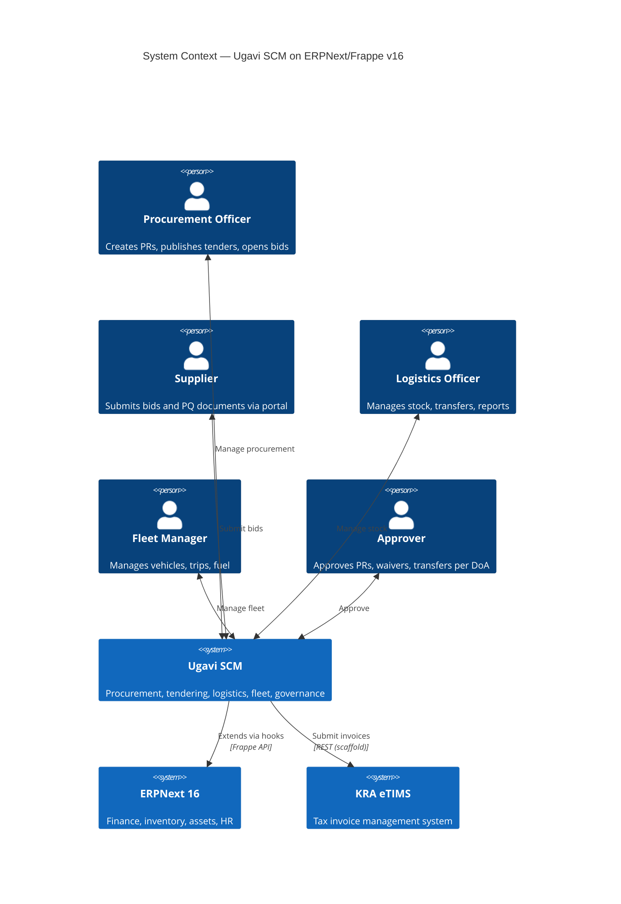
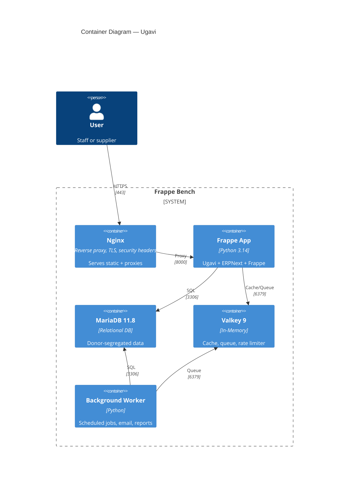
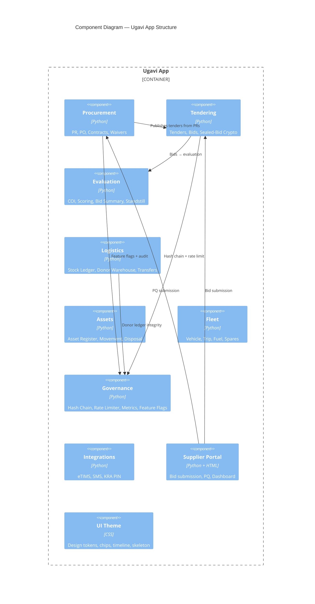

# C4 Architecture — Ugavi 0.1.0

## Level 1: System Context

## Level 2: Container

## Level 3: Component — Ugavi App

## Key Design Decisions

| Decision | Rationale | ADR |
|----------|-----------|-----|
| Single tenant, donor-as-dimension | Simplest ops; donor segregation via code | ADR-001 |
| RSA-4096 + AES-256-GCM sealed bids | Industry standard; SSS 3-of-3 key split | ADR-002 |
| AI features off-by-default, no sealed-bid data | Prevents data leakage; adapter pattern | ADR-003 |
| Frappe UI (Vue 3 + Tailwind) for Desk | Upgrade-safe; no separate frontend | ADR-005 |
| Zero core ERPNext patches | Guarantees upgrade safety; all via hooks | UG1/UG2 |

*Generated 2026-10-19. Diagrams in Mermaid format, rendered in CI.*