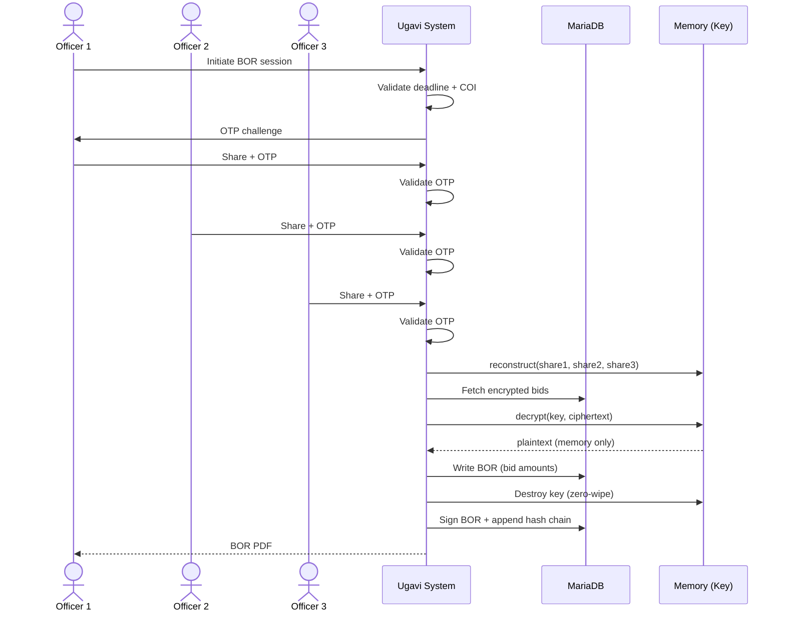

# UC-05: Open Sealed Bids (3-Officer Protocol)

**ID:** UC-05 | **Actor(s):** 3 Bid Opening Officers (BOR1, BOR2, BOR3) | **Phase:** Tendering
**Requirements:** TN8, TN9, TN10, TN11, TN12, TN13, TN14

## Goal
Three distinct officers collaboratively decrypt sealed bids after tender deadline, producing a signed Bid Opening Record with immutable audit trail.

## Trigger
Tender deadline passes → system transitions tender to "Bids Received" → BOR session scheduled.

## Preconditions
- Tender status = "Bids Received" or "Under Evaluation"
- Minimum 3 submitted bids present
- 3 distinct officers assigned to BOR (each has valid OTP seed)
- No officer is conflicted (COI check passes for all 3)
- At least 3 private-key shares issued (Shamir's 3-of-3)

## Main Flow

1. **Officer 1 initiates BOR session** — selects tender, system validates deadline passed, COI clear
2. **System generates OTP challenges** — 6-digit OTP sent to each officer via SMS/email
3. **Officer 1 submits share + OTP** — system validates OTP (5-min expiry, 3-attempt limit)
4. **Officer 2 submits share + OTP** — same validation
5. **Officer 3 submits share + OTP** — same validation
6. **System reconstructs private key** — Shamir's 3-of-3: `k = reconstruct(share1, share2, share3)`
7. **System decrypts all bids sequentially** — AES-256-GCM envelope decryption
8. **System records decrypted amounts** — creates Bid Opening Record with bid amounts, supplier names, timestamps
9. **System destroys reconstructed key** — memory-only; zero-padded overwrite after decryption
10. **System signs BOR** — SHA-256 hash of BOR content appended to hash chain
11. **System generates BOR PDF** — signed PDF with hash, officer names, timestamps
12. **System transitions tender to "Under Evaluation"**

## Alternate/Exception Flows

| Flow | Condition | Action |
|------|-----------|--------|
| A1 | OTP expires (5 min) | Re-generate OTP; increment attempt counter |
| A2 | 3 failed OTP attempts | Lock officer for 15 minutes; alert admin |
| A3 | Less than 3 shares submitted | BOR fails; tender stays "Bids Received" |
| A4 | COI detected mid-session | Halt BOR; exclude conflicted officer; require replacement |
| A5 | 1 or 2 officers try to open | **Rejected** — SSS 3-of-3 ensures no partial decryption |
| A6 | Admin queries plaintext from DB | **Rejected** — no plaintext stored; key never persisted |

## Business Rules
- **TN12-R1:** Minimum 3 distinct shares required for any decryption
- **TN13-R1:** Private key NEVER stored in DB; reconstructed in memory only
- **TN10-R1:** OTP: 6-digit numeric, TTL=300s, max_attempts=3 per officer
- **TN11-R1:** Every action logged with: officer, IP, timestamp, outcome, hash

## Postconditions
- BOR record created (docstatus=1, signed)
- BOR PDF generated and attached
- Hash chain updated with BOR hash
- All bids transitioned to "Opened"
- Tender → "Under Evaluation"
- OTP seeds destroyed (one-time use)
- Private key destroyed from memory

## Data/Documents Touched
- `Tender` (status update)
- `Bid` (decryption → status "Opened")
- `Bid Opening Record` (new, signed)
- `Sealed Bid Key` (share verification)
- `OTP Log` (attempt recording)
- `Audit Log` (hash chain append)

## Permissions
| Role | Perm |
|------|------|
| Bid Opening Officer | Read Tender, Read Bid (encrypted), Create BOR |
| System | Decrypt Bid, Sign BOR, Append Hash Chain |
| Other roles | No access to unopened bids |
| Admin/DB | No plaintext access (TN13 enforced in code) |

## Audit Events
- BOR session initiated (officer, IP, timestamp)
- OTP generated (hash, not plaintext)
- OTP submitted (success/fail)
- Share submitted (officer index)
- Key reconstructed (timestamp; no key logged)
- Bid decrypted (bid ID, timestamp)
- BOR signed (hash)
- Hash chain appended (previous_hash → new_hash)

## Linked Tests
- `test_crypto.py::TestSealedBidCrypto` — split/reconstruct/decrypt
- `test_crypto.py::TestKeyDistribution` — distinct officers, no private_key field
- `test_domain.py::TestSegregationOfDuties` — same role rejection
- `test_transactional_boundary.py` — bid opening rollback
- `test_concurrency.py` — parallel bid open prevention

## Sequence Diagram
